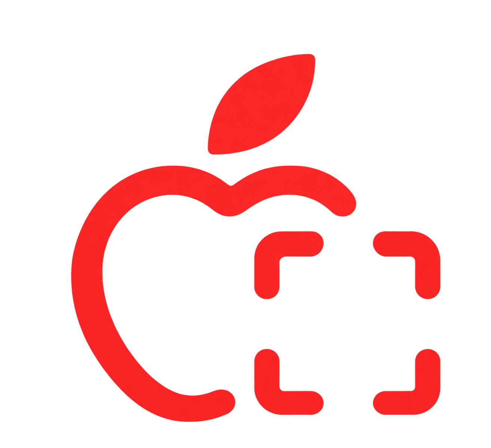

<p align="center">
  
</p>

<h1 align="center">NutriScan — AI Calorie Scanner & Macro Food Tracker</h1>

<p align="center">
  <strong>An intelligent AI-powered nutrition scanner and macro tracking web application inspired by Apple Health and mobile aesthetics.</strong>
</p>

<p align="center">
  <a href="#ui-preview">UI Preview</a> •
  <a href="#features">Features</a> •
  <a href="#tech-stack">Tech Stack</a> •
  <a href="#project-structure">Project Structure</a> •
  <a href="#getting-started">Getting Started</a> •
  <a href="#api-reference">API Reference</a> •
  <a href="#license">License</a>
</p>

<p align="center">
  
  
  
  
  
  
  
</p>

---

## 📸 UI Preview

<p align="center">
  
</p>

---

## 🌟 Overview

**NutriScan** is a modern, responsive web application designed for seamless daily macronutrient logging, AI-driven nutritional scanning, and dietary goal management. Powered by **Google Gemini 2.5**, NutriScan allows users to capture or upload photos of nutritional fact labels or cooked dishes to instantly extract detailed macronutrient breakdowns (calories, protein, carbs, fats, vitamins, sodium) along with estimated prices, ingredients, and health score ratings.

With an aesthetic inspired by Apple Health and modern cyber console interfaces, NutriScan bridges intelligent computer vision with intuitive daily meal tracking, hydration monitoring, and culturally rich culinary databases (including Persian and international cuisines).

---

## ✨ Features

- 🔍 **Multimodal AI Food Scanner (Google Gemini)**:
  - Scan printed nutrition facts labels or cooked dish photos via device camera or file upload.
  - Automatically identifies product name, cuisine, calories, protein, carbs, total fats, saturated fat, sodium, fiber, sugars, and micronutrients.
  - Generates comprehensive health ratings (A–E, 1–100 score), nutritional highlights, allergen alerts, and cultural dish context.
  - Built-in fallback demo mode for seamless offline testing without an API key.

- 🍏 **Apple Health-Inspired Dashboard**:
  - Interactive **Activity Rings** visualizing daily calorie burn vs. targets alongside macronutrient goals (Protein, Carbs, Fat).
  - Elegant stepper controls, segmented pickers, custom sliders, and animated histogram charts.
  - Quick-glance stat tiles and progress indicators powered by **Framer Motion**.

- 📱 **Dual View Modes (Desktop Console & Android Device)**:
  - Toggle between a wide-screen command center console with collapsible sidebars and an authentic Android device mockup.
  - Fully responsive across desktop, tablet, and mobile displays.

- 🗄️ **Local-First SQLite Food Diary**:
  - Persistent daily meal logging backed by SQLite (`better-sqlite3` in WAL mode).
  - Categorize meals by date and time (Breakfast, Lunch, Dinner, Snack).
  - Dynamic serving-size multipliers, instant entry deletion, and live SQLite database health telemetry (page count, cache size, WAL memory).

- 💧 **Interactive Water Tracker**:
  - Log daily hydration with 1-click 250ml glass steppers.
  - Set custom fluid intake targets with visual cup meters and reset capabilities.

- 🥘 **Persian & International Heritage Cuisine Database**:
  - Extensive built-in catalog of authentic Persian dishes (Ghormeh Sabzi, Chelo Kabab Koobideh, Fesenjan Walnut Stew, Ash Reshteh, Tahchin, etc.) and global foods (Asian, Middle Eastern, European, American).
  - Cultural recipe summaries, ingredients lists, and regional origin tags.
  - Dynamic daily featured dishes with instant one-click logging.

- 💰 **Smart Economic Pricing (IRT & USD)**:
  - Estimated ingredient and dish preparation costs in Iranian Toman (IRT) and US Dollars (USD).
  - Integrated currency conversion with live/indexed exchange rate endpoints (`/api/exchange-rate`).

- 🌐 **Bilingual & Responsive Theming**:
  - English and Persian (Farsi / فارسی) language localization.
  - Light, Dark, and System theme modes with tailored typography (Poppins, Vazirmatn, JetBrains Mono).

---

## 🛠️ Tech Stack

| Category | Technology |
| :--- | :--- |
| **Frontend Framework** | [React 19](https://react.dev/) + [TypeScript](https://www.typescriptlang.org/) |
| **Build Tool** | [Vite 6](https://vitejs.dev/) |
| **Styling & Design** | [Tailwind CSS v4](https://tailwindcss.com/) + [Radix UI](https://www.radix-ui.com/) |
| **Animations & Icons** | [Motion (Framer Motion)](https://motion.dev/) + [Lucide React](https://lucide.dev/) |
| **Backend Server** | [Express](https://expressjs.com/) on Node.js (with `tsx` for TypeScript execution) |
| **Artificial Intelligence** | [Google Gemini 2.5 API](https://ai.google.dev/) (`@google/genai` SDK) |
| **Database** | [SQLite](https://sqlite.org/) via `better-sqlite3` (WAL mode enabled) |

---

## 📁 Project Structure

```text
macro-tracker-web-app/
├── api/                     # Vercel serverless functions / API route handlers
│   ├── exchange-rate.ts     # Live currency exchange rate handler
│   ├── health.ts            # System health check endpoint
│   ├── index.ts             # Vercel serverless entrypoint
│   └── scan-label.ts        # Gemini multimodal scan handler
├── public/                  # Static assets and media
│   ├── logo.png             # NutriScan high-res branding logo
│   ├── apple-scan-logo.png  # Apple Health scan mark
│   ├── Pasted image.png     # Application preview screenshot
│   └── site.webmanifest     # PWA web manifest
├── server/                  # Local SQLite database service
│   └── sqliteDb.ts          # SQLite schema, queries, water records & stats
├── src/
│   ├── components/          # Core React UI components
│   │   ├── apple/           # Apple Health-styled widgets (ActivityRing, WaterTracker, etc.)
│   │   ├── ui/              # Radix UI primitives (Button, Dialog, Slider, Tabs, etc.)
│   │   ├── AndroidFrame.tsx # Mobile device simulator container
│   │   ├── ConsoleHeader.tsx# App header, currency selector, theme & language switches
│   │   ├── ConsoleSidebars.tsx # Navigation and vitals panes
│   │   ├── DiaryConsoleView.tsx# SQLite food diary log and SQLite diagnostics
│   │   ├── GoalsConsoleView.tsx# Calorie, macro, water, and budget goal settings
│   │   ├── NutritionModal.tsx  # Detailed nutrient inspection dialog
│   │   └── ScannerConsoleView.tsx # Camera & upload scanning interface
│   ├── utils/               # Currency converters, dish helpers, and formatters
│   ├── worldFoods.ts        # Built-in international & Persian dish database
│   ├── recommendedDishes.ts # Daily featured dishes generator
│   ├── translations.ts      # Bilingual English / Persian localization dictionary
│   ├── types.ts             # TypeScript definitions
│   ├── App.tsx              # Main application orchestrator
│   └── main.tsx             # React DOM root entry
├── server.ts                # Express backend application
├── package.json             # NPM scripts and dependencies
├── tsconfig.json            # TypeScript configuration
└── vite.config.ts           # Vite + Tailwind CSS plugins
```

---

## 🚀 Getting Started

### Prerequisites

- **Node.js** `>= 20.0.0`
- **npm** `>= 9.0.0`
- *(Optional)* A Google Gemini API key from [Google AI Studio](https://aistudio.google.com/app/apikey)

### 1. Clone the Repository

```bash
git clone https://github.com/sina-sparkn/macro-tracker-web-app.git
cd macro-tracker-web-app
```

### 2. Install Dependencies

```bash
npm install
```

### 3. Configure Environment Variables

Create a `.env` file in the project root:

```bash
cp .env.example .env
```

Add your Gemini API key (optional for demo fallback):

```env
# Google Gemini API Key for Food Label & Dish Image Scanning
# Get your API key at: https://aistudio.google.com/app/apikey
GEMINI_API_KEY=your_gemini_api_key_here

# Optional: Server Port (default: 3000)
PORT=3000
```

### 4. Run the Development Server

```bash
npm run dev
```

Open your browser and navigate to `http://localhost:3000`.

### 5. Production Build

To build the frontend bundle and bundle the Express server:

```bash
npm run build
npm start
```

---

## 📡 API Reference

| Method | Endpoint | Description |
| :--- | :--- | :--- |
| `POST` | `/api/scan-label` | Analyze an uploaded food label or dish image using Gemini 2.5 multimodal vision. |
| `GET` | `/api/diary` | Fetch all recorded meals and SQLite database metrics for the diary. |
| `POST` | `/api/diary` | Record a new food item into the SQLite database. |
| `POST` | `/api/diary/seed` | Seed default sample meals for instant demonstration. |
| `DELETE`| `/api/diary/:id` | Remove a specific logged item from the SQLite diary. |
| `DELETE`| `/api/diary` | Reset and clear all diary records. |
| `GET` | `/api/water` | Retrieve water intake records by date. |
| `POST` | `/api/water` | Update current day's water consumption (glasses / ml). |
| `GET` | `/api/exchange-rate`| Fetch current or indexed IRT / USD exchange rate. |

---

## 📄 License

This project is licensed under the [Apache 2.0 License](https://www.apache.org/licenses/LICENSE-2.0).
